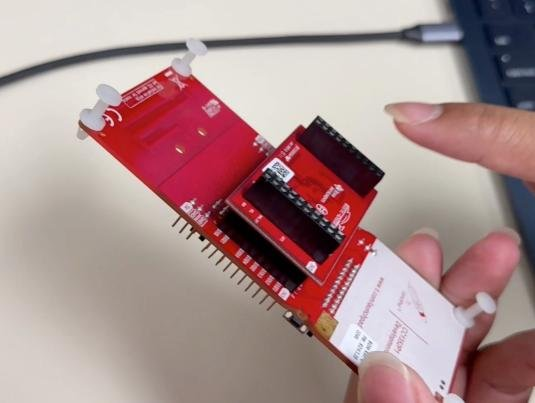
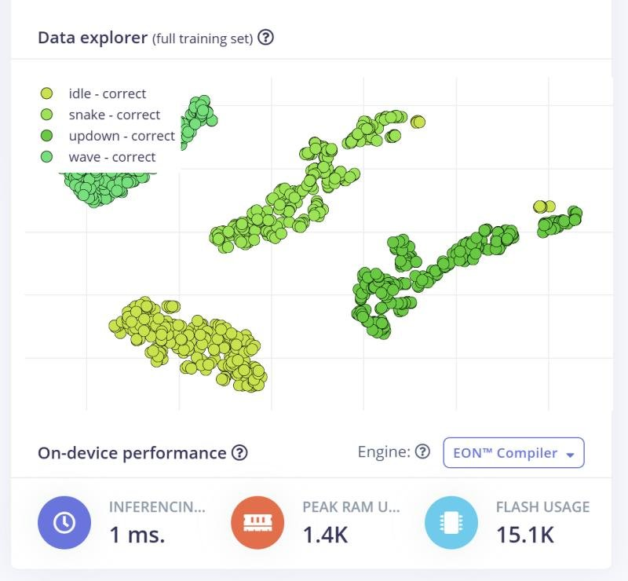
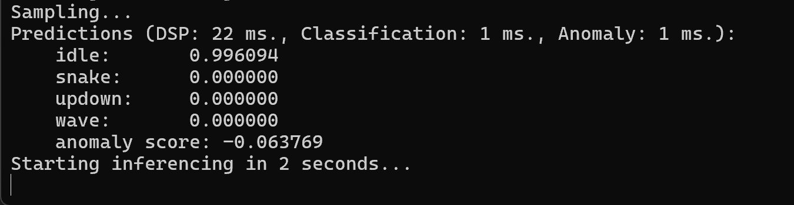
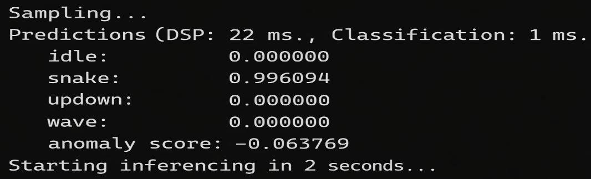
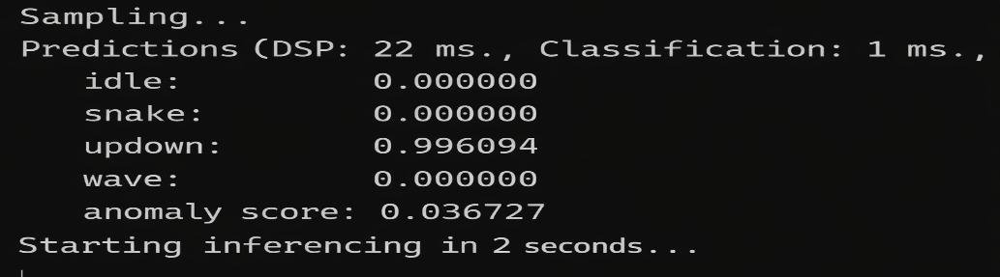
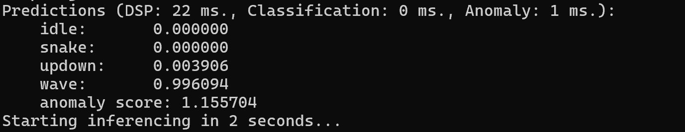
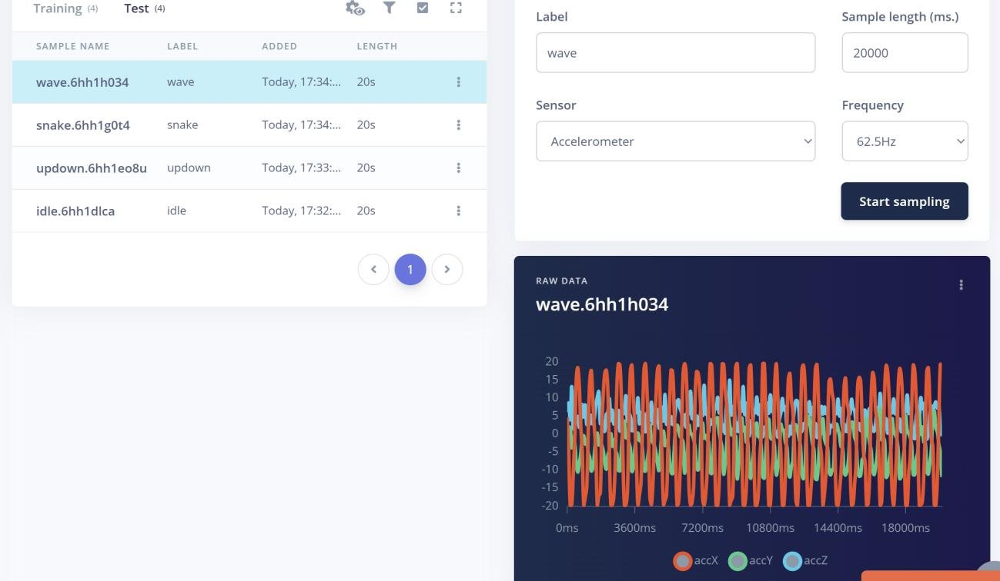
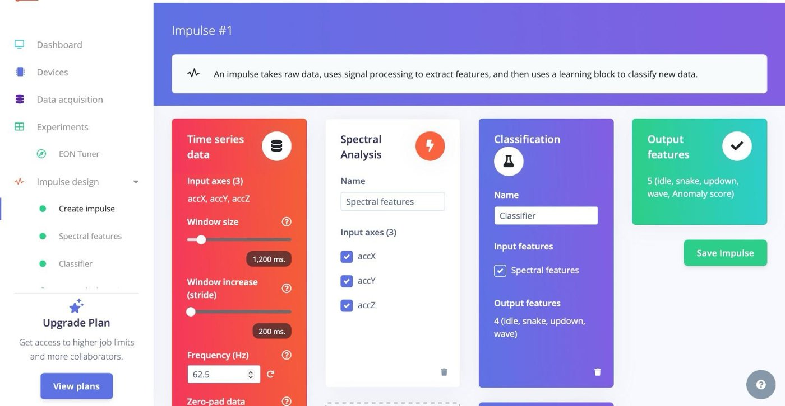
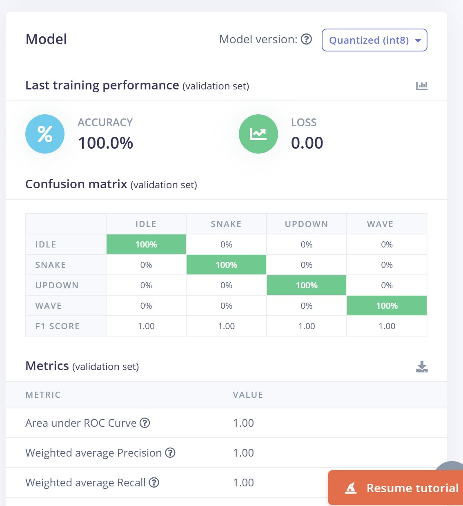
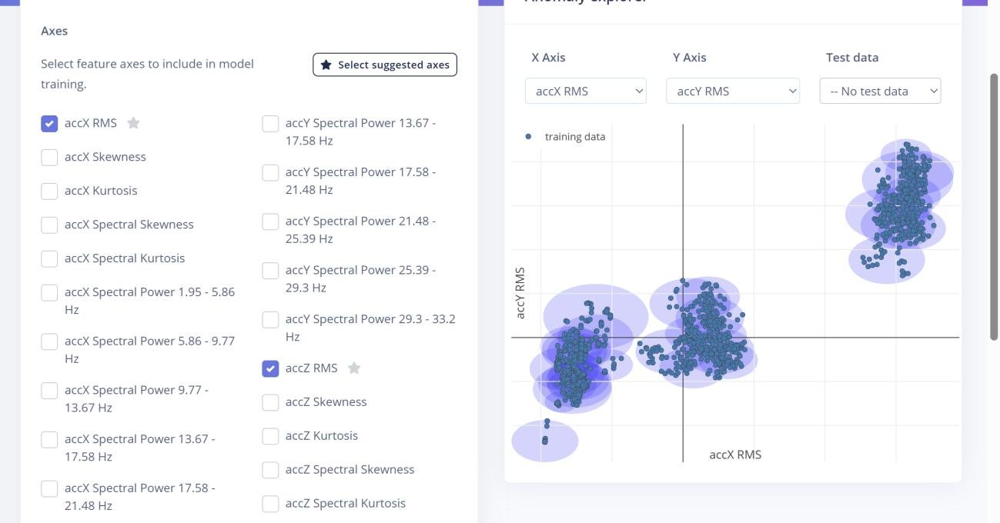

# 👋 GestureSense — Edge AI Gesture Recognition with Anomaly Detection (TinyML)

> **A neural network on a microcontroller that knows how you move, and notices when it doesn't.**


An on-device **gesture / motion classifier** running on a TI **LAUNCHXL-CC1352P1** with the **BOOSTXL-SENSORS** BoosterPack. 3-axis accelerometer data is used to train a neural network in **Edge Impulse** that recognises four motions: **IDLE, UP-DOWN, WAVE, SNAKE**. A **K-means anomaly detector** flags motions it was never trained on.

<p align="center"> </p>

## Results

| Metric | Value |
|---|---|
| Validation accuracy (quantized int8) | **100 %** |
| Live on-device classification | **> 98 %** per class |
| On-device inference / peak RAM / flash | 1 ms · 1.4 KB · 15.1 KB |

| IDLE | SNAKE | UP-DOWN | WAVE |
|---|---|---|---|
|  |  |  |  |

## Hardware & Software

- TI **LAUNCHXL-CC1352P1** (ARM Cortex-M4F @ 48 MHz, multiband sub-1 GHz / 2.4 GHz)
- TI **BOOSTXL-SENSORS** (BMI160 accelerometer + gyro, BMM150, BME280, OPT3001, TMP007)
- **Edge Impulse Studio** + **Edge Impulse CLI**, Node.js ≥ 14, Python 3

## ML Pipeline (Impulse)

| Stage | Configuration |
|---|---|
| Data acquisition | 3-axis acceleration @ **62.5 Hz**, 10 s per sample, 10 samples per class, 80/20 train/test |
| Pre-processing | **Spectral Analysis** – low-pass filter + FFT features per axis |
| Learning block 1 | **Neural network classifier** (Keras dense NN) → idle / snake / updown / wave |
| Learning block 2 | **Anomaly detection (K-means)**, 32 clusters on accX/accY/accZ **RMS** |
| Deployment | Firmware binary for LAUNCHXL-CC1352P1 (EON™ compiler, int8) |

RMS is used for anomaly clustering because acceleration is directional; components can cancel out in a plain average, while RMS captures overall magnitude.

## Reproduce

```bash
npm install -g edge-impulse-cli --force   # Edge Impulse CLI
./scripts/flash_firmware.sh                # see script: flash default EI firmware
edge-impulse-daemon --clean                # connect board to your EI project
```

1. **Data acquisition** – record each class (wave, snake, updown, idle) for 10 s × 10 samples.
2. **Create impulse** – Time-series input → Spectral Analysis → Classification + Anomaly Detection (K-means).
3. **Generate features**, check class separation in the Feature Explorer.
4. **Train** – aim for > 80 % (achieved 100 %). Select RMS features for anomaly detection.
5. **Live classification** – validate with new motions.
6. **Deploy** – build the LAUNCHXL-CC1352P1 binary, flash with the included `flash_*` script, then run `edge-impulse-run-impulse` to watch predictions.

## Gallery

| Data acquisition | Impulse design | Confusion matrix | Anomaly clusters |
|---|---|---|---|
|  |  |  |  |


## Concepts Covered

- Supervised classification vs. unsupervised clustering (K-means) for anomaly detection
- Frequency-domain feature extraction for time-series sensor data
- Deploying a quantized neural network on a resource-constrained MCU (TinyML)

## Authors

- **Shrinath Abhay Palwankar**
- **Aryan Verma**
